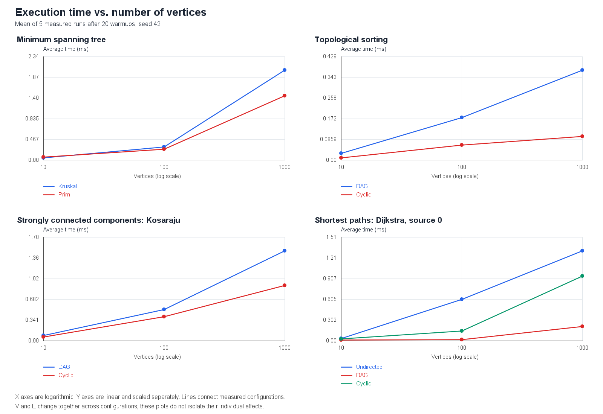
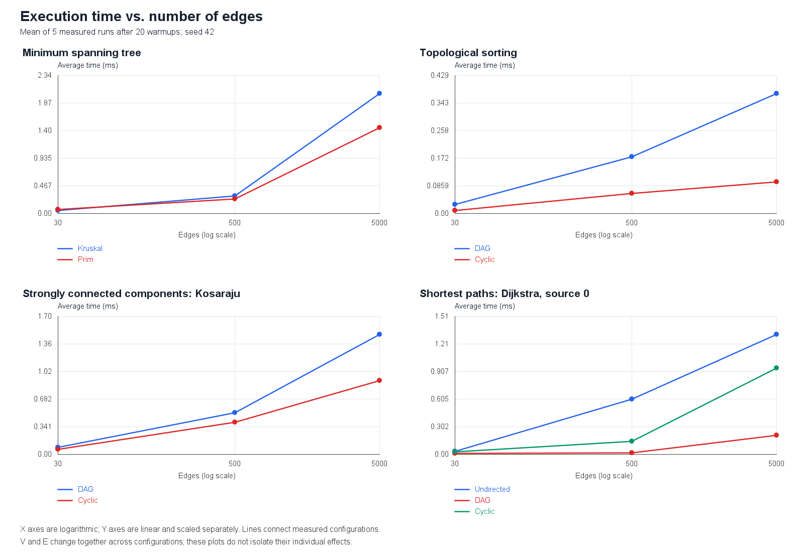

# Smart City Infrastructure and Route Planning

Assignment 3 — Design and Analysis of Algorithms.

## Overview

This Java application models a city's infrastructure as a weighted graph.
Vertices represent districts, and edges represent roads. Weights represent
construction costs or travel distances.

Implemented: weighted graph representation, optimized Disjoint Set Union
(DSU), Kruskal's and Prim's MST algorithms, topological sorting with cycle
detection, Kosaraju's strongly connected components, and Dijkstra's shortest
distances with route reconstruction.

Reproducible experiments cover three graph sizes, with five measured
runs per configuration. Results include execution times, operation counts,
two plots, and a comparison of theoretical and experimental behavior.

## Implementation

The project uses Java 17 and requires no external libraries.

### Graph Representation

- `Edge` is an immutable record containing `from`, `to`, and `weight`.
- `WeightedGraph` supports directed and undirected graphs.
- Vertices are numbered from 0 to V - 1.
- Adjacency lists store outgoing edges for each vertex.
- A separate edge list stores each added road once.
- Undirected roads have reverse adjacency entries.
- An undirected self-loop has one adjacency entry.
- Parallel edges, equal weights, and isolated vertices are supported.
- Weights use `long`.
- Invalid vertex IDs are rejected before modifying the graph.
- Returned edge lists are read-only views.

The graph permits negative weights. Dijkstra rejects them because
its correctness requires non-negative weights.

### Disjoint Set Union

`DisjointSetUnion` stores a parent array, component sizes, and the
current number of components. Initially, each element is a separate set.

`find` uses iterative full path compression: after finding the root,
it redirects every element on the visited path directly to that root.

`union` uses union by size: the smaller component is attached to the
larger component. It returns false if both elements are already connected.

Component sizes are stored at roots. The representative is not necessarily
the smallest element in a component.

The implementation also provides connectivity queries, component sizes,
component counts, and immutable statistics snapshots.

### Operation Counters

| Counter | Definition |
| --- | --- |
| findCalls | Valid find calls, including calls made by other DSU methods |
| unionCalls | Valid union attempts, including redundant attempts |
| successfulUnions | Attempts that merge different components |
| parentTraversals | Parent links followed during the root-search pass |
| pathCompressionWrites | Parent entries changed during compression |

Parent traversals exclude the compression pass.
Compression writes exclude links created by union.

Resetting statistics does not reset components or undo path compression.
Each measured Kruskal run creates a fresh DSU.

### Kruskal's Algorithm

Kruskal processes a copy of the logical edge list sorted by weight.
An edge is selected only when DSU successfully merges its endpoints'
components. Edges that would create cycles are rejected.

Processing stops when one component remains or all edges have been
examined. A disconnected graph produces a minimum spanning forest.

Directed graphs are rejected. Negative weights, parallel edges, and
equal weights are supported. Self-loops are never selected.

`MstResult` contains an immutable copy of the selected edges, their total
weight, the component count, and operation counters.

A single-vertex graph is connected and has total weight zero.
For an empty graph, the component count is zero and isConnected is false.

Weights and totals use long. Math.addExact throws ArithmeticException
if an intermediate accumulated total exceeds the long range.

### Prim's Algorithm

Prim uses a visited array and Java's PriorityQueue, implemented as a
binary heap. Starting from an unvisited vertex, it adds outgoing edges
whose destinations have not been visited.

The cheapest queued edge is extracted next. If its destination is already
visited, the entry is discarded. Otherwise, the edge is selected and the
new vertex's outgoing edges are examined.

This is lazy Prim: obsolete entries remain in the queue until extracted.
The outer loop starts a new tree for each unvisited component, so
disconnected graphs produce a minimum spanning forest.

Directed graphs are rejected. Negative weights and parallel edges are
supported; self-loops are not selected. Totals use Math.addExact with
the same intermediate-overflow checks as Kruskal.

### MST Operation Counters

| Counter | Kruskal | Prim |
| --- | --- | --- |
| edgeExaminations | Edges inspected after sorting | Adjacency entries inspected when visiting vertices |
| weightComparisons | Sorting comparator calls | Priority queue comparator calls |
| dsuFindCalls | Calls reported by DSU | Zero |
| dsuUnionCalls | Attempts reported by DSU | Zero |
| queueOffers | Zero | Edges inserted into the queue |
| queuePolls | Zero | Entries removed, including obsolete entries |

Kruskal performs one union attempt and two find calls per examined edge.

Prim visits every vertex and scans every adjacency list. For an
undirected graph with E logical edges and L self-loops, it examines
2E - L adjacency entries. Each non-loop edge enters the queue once,
and the queue is fully drained for each component.

The counters describe different operations and must be interpreted
using these definitions rather than treated as interchangeable totals.

### City Demonstration

Running app.Main demonstrates all implemented graph tasks:

- Kruskal and Prim both produce an MST with total weight 14.
- Topological sorting returns [3, 1, 0, 2] for the dependency DAG.
  Adding a back edge creates a cycle, which is detected.
- Kosaraju identifies SCCs {0, 1, 2}, {3, 4}, and {5}.
  Component and vertex ordering are not part of the correctness contract.
- Dijkstra reports distances and reconstructed routes from district 0:
  distances to districts 0 through 4 are 0, 3, 1, 4, and 7.
  District 5 is unreachable.

The optional command-line argument selects the source district, from 0 to 5.
The default is 0. In IntelliJ, set Program arguments in the Main run
configuration to choose another source.

The demonstrations use separate graphs for construction costs,
infrastructure dependencies, directed connectivity, and travel distances.

### Topological Sorting

`TopologicalSort` implements Kahn's algorithm for directed graphs.

It first counts incoming edges for every vertex. Vertices with zero
indegree enter an ArrayDeque used as a FIFO queue. Removing a vertex
reduces the indegrees of its outgoing neighbors. A neighbor enters
the queue when its indegree becomes zero.

If every vertex is processed, the result contains a valid topological
ordering. Otherwise, the graph contains a cycle.

On cyclic input, hasCycle is true and the returned order is empty.
A partially processed order is not exposed as a valid result.
An empty directed graph is a DAG with an empty ordering.

Undirected input is rejected. Edge weights do not affect the ordering.
Parallel edges are counted and processed individually.

The result stores an immutable copy of the order and these counters:

- `edgeExaminations`: edges scanned during indegree initialization,
  plus outgoing adjacency entries scanned during vertex processing.
- `queueOffers`: vertices inserted into the queue.
- `queuePolls`: vertices removed from the queue.

For a DAG, edgeExaminations equals 2E and both queue counters equal V.
For cyclic graphs, processing may stop before every vertex is visited.

### Strongly Connected Components

Kosaraju's algorithm identifies strongly connected components in directed
graphs. Within each component, every vertex is reachable from every other
vertex.

The first DFS pass records vertices in finishing order. The algorithm then
reverses every edge and performs a second DFS pass in reverse finishing
order. Each traversal in the second pass produces one SCC.

Both passes use an explicit stack instead of recursion. Isolated vertices
form individual components. Parallel edges and self-loops are supported;
edge weights do not affect connectivity. Undirected graphs are rejected.

The result contains immutable component lists and operation counters.
Every vertex belongs to exactly one component.

The edge examination counter includes the first DFS pass, construction
of the reversed graph, and the second DFS pass: exactly 3E examinations.
The vertex visit counter records one visit per vertex in each DFS pass:
exactly 2V visits.

### Dijkstra's Shortest Paths

Dijkstra's algorithm finds shortest distances from a selected source and
records predecessors to reconstruct routes. It supports directed and
undirected graphs with non-negative weights.

A priority queue selects the smallest tentative distance. Each successful
relaxation inserts a new queue entry. Outdated entries are skipped when
removed from the queue.

All edge weights are validated before the search, including edges in
unreachable components. Negative weights are rejected.

Unreachable vertices have an empty OptionalLong distance and an empty
path. The source has distance zero and a path containing only itself.
Result arrays are defensively copied, and returned paths are immutable.

Distances use long. Long.MAX_VALUE is a valid distance, distinct from
unreachability. Overflowing candidate routes are skipped. If a reachable
vertex has no route whose distance fits in long, the algorithm throws
ArithmeticException instead of reporting it as unreachable.

Operation counters record:
- Logical edges examined during weight validation.
- Adjacency entries examined during the search.
- Successful relaxations.
- Priority queue offers, polls, and comparator calls.

Validation examines E logical edges. During the search, each reachable
vertex's adjacency list is scanned once. Queue offers equal successful
relaxations plus one for the source. Queue polls include outdated entries.

### Why Negative Weights Are Not Supported

Dijkstra's greedy argument relies on non-negative weights: a vertex
extracted with the smallest tentative distance cannot later obtain a
shorter route through an unsettled vertex.

Negative edges invalidate this argument. For example, with edges
s -> a (2), s -> b (5), and b -> a (-10), a standard Dijkstra implementation
that finalizes vertices would finalize a at distance 2, although its
shortest distance is -5.

Bellman-Ford is an alternative when negative edges are allowed.
Reachable negative cycles can make finite shortest distances undefined.

## Complexity Analysis

### Graph Representation

The representation uses O(V + E) space.

| Operation | Time complexity |
| --- | --- |
| Create a graph with V vertices | O(V) |
| Add an edge | O(1) amortized |
| Get vertex or edge count | O(1) |
| Traverse a vertex's outgoing edges | O(out-degree) |
| Traverse the logical edge list | O(E) |

### DSU

| Operation | Time complexity |
| --- | --- |
| Initialize V elements | O(V) |
| find and union | O(alpha(V)) amortized |
| connected and componentSize | O(alpha(V)) amortized |
| elementCount and componentCount | O(1) |
| Read or reset statistics | O(1) |

Alpha is the inverse Ackermann function, which grows extremely slowly.
The amortized bound applies across a sequence of operations.

Union by size alone limits tree height to O(log V): when an element's
depth increases, its containing component at least doubles in size.
Path compression shortens future searches. Together, these optimizations
give the O(alpha(V)) amortized bound. A single operation can still take
O(log V) time.

DSU stores O(V) data. Its iterative operations use O(1) extra working space.
Processing E roads takes O(V + E alpha(V)) amortized time, including
initialization.

### Kruskal

Creating DSU takes O(V) time. Copying and sorting E edges takes
O(E log(E + 1)) time. Processing edges takes O(E alpha(V)) amortized time.

The general total bound is
O(V + E log(E + 1) + E alpha(V)).
For connected graphs with at least two vertices, this simplifies
to O(E log E).

Additional space is O(V + E), including DSU, the copied edge list,
sorting workspace, and the selected edges.

More edges increase sorting and processing work. More vertices increase
DSU initialization and storage. Isolated vertices are included in V.

### Prim

The visited array and outer loop require O(V) time. Scanning all
adjacency lists takes O(V + E) time.

Each non-loop edge is inserted into and removed from the binary heap
once. The heap may contain O(E) entries, including obsolete entries.
Therefore, this lazy implementation takes O(V + E log(E + 1)) time.

Additional space is O(V + E): the visited array, selected edges,
and priority queue.

The bound uses log E because this implementation stores candidate edges
in the heap and does not use a decrease-key operation with one entry
per vertex.

### Topological Sorting

Initializing indegrees and scanning the edges takes O(V + E) time.
Each vertex enters and leaves the queue at most once.
Each outgoing adjacency entry is processed at most once after
the initial indegree calculation.

Total time is O(V + E), including cycle detection.
Additional space is O(V) for indegrees, the queue, and the output order.
The input graph is not copied.

Increasing V adds vertex initialization and queue work; increasing E
adds indegree updates and adjacency scans.

### Kosaraju's Algorithm

Time complexity: O(V + E). Each DFS pass processes every vertex and edge,
and constructing the reversed graph takes O(V + E) time.

Additional space complexity: O(V + E). The reversed adjacency lists store
V vertices and E edges. Visited arrays, finishing order, the explicit stack,
and component lists require O(V) space.

Increasing either the number of vertices or edges increases the amount
of work linearly. These bounds assume an adjacency-list representation.

### Dijkstra's Algorithm

With adjacency lists and Java's binary-heap PriorityQueue, time complexity
is O(V + E log(E + 2)), including validation of all E edge weights.

This implementation inserts a new entry for every successful relaxation
instead of using decrease-key. There are O(E) successful relaxations and
O(E + 1) queue entries over the run. Outdated entries are skipped without
rescanning adjacency lists.

Additional space complexity is O(V + E): distance, reachability, predecessor,
and overflow-tracking arrays use O(V), while the queue can contain O(E)
entries. The result also stores O(V) data.

More vertices increase array initialization and storage costs. More edges
increase validation, adjacency scanning, and potential heap operations.
Only vertices reachable from the source have their adjacency lists scanned.

A distance or reachability query takes O(1). Reconstructing a path of
k vertices takes O(k) time and additional space. Producing paths for all
vertices can require O(V squared) total output in the worst case; this is
separate from computing shortest distances.

## Running the Project

1. Open the repository in IntelliJ IDEA.
2. Select JDK 17 and language level 17.
3. Mark `src` as Sources Root.
4. Mark `tests` as Test Sources Root.
5. Run `app.Main` for the demonstration.
6. Run `graph.WeightedGraphTest` for the graph tests.
7. Run `dsu.DisjointSetUnionTest` for the DSU tests.
8. Run `mst.KruskalTest` for the Kruskal tests.
9. Run `mst.PrimTest` for the Prim tests and randomized MST comparison.
10. Run `connectivity.TopologicalSortTest` for topological sorting tests.
11. Run `connectivity.KosarajuTest` for the SCC tests.
    Expected final message: `All 8 SCC tests passed.`
12. Run `shortestpath.DijkstraTest` for the shortest-path tests.
        Expected final message: `All 10 Dijkstra tests passed.`
13. Run `benchmark.GraphGeneratorTest` for the graph generator tests.
        Expected final message: `All 5 graph generator tests passed.`
14. Run `benchmark.BenchmarkRunner` to reproduce the measurements.
    This writes `raw-runs.csv`, `averages.csv`, and `environment.txt`
    into `results/tables`.
15. Run `benchmark.PlotGenerator` to generate both execution-time plots
    from `results/tables/averages.csv`.

Use the repository root as the working directory for both generators.
Run benchmarks normally, without the debugger. Java 17 or later is
required; no external libraries are needed.

Running BenchmarkRunner replaces the saved measurement files.
Running PlotGenerator replaces the saved plots. After repeating the
benchmarks, regenerate the plots and update the README tables and discussion
to match the new measurements.

The fixed seed reproduces graph inputs and operation counts.
Execution times will vary between runs and computers.

## Experimental Setup

### Graph Configurations

| Configuration | Vertices (V) | Logical edges (E) |
| --- | ---: | ---: |
| Small | 10 | 30 |
| Medium | 100 | 500 |
| Large | 1000 | 5000 |

All graphs are generated using java.util.Random with seed 42.
Edge weights are integers from 1 to 100. Self-loops and duplicate edges
are excluded. An undirected road counts as one logical edge, although
it appears in both endpoints' adjacency lists.

Three datasets are generated for each size:

- Connected undirected: each vertex after vertex 0 connects to a randomly
  selected earlier vertex, creating a spanning tree. Additional unique
  edges are added until the required edge count is reached.
- DAG: vertices are shuffled into a random order. Edges are added only
  from earlier to later positions, guaranteeing acyclicity.
- Cyclic directed: edges 0 -> 1, 1 -> 2, and 2 -> 0 guarantee a cycle.
  Additional unique directed edges are added randomly. Connectivity of
  the entire graph is not guaranteed.

These generation procedures are reproducible but do not sample uniformly
from all possible graphs with the specified properties.

### Measurement Procedure

Experiments use Microsoft OpenJDK 17.0.18. Additional environment details
are recorded in [environment.txt](results/tables/environment.txt).

Each algorithm/dataset/size combination receives 20 unmeasured warmup runs,
followed by exactly 5 measured runs using System.nanoTime().
The reported time is the arithmetic mean of those five runs.

One graph is generated per dataset and size and reused for all runs.
Kruskal and Prim receive the same undirected graph. Dijkstra uses source
vertex 0 on all three datasets. Topological sorting and Kosaraju run on
both directed datasets.

Timed intervals include algorithm execution, internal allocations, and
operation counting. Dijkstra's validation of all edge weights and
Kosaraju's reversed-graph construction are included.

Graph generation, result checks, CSV formatting, console output, and file
writing are outside timed intervals. Dijkstra's path reconstruction is
also outside the benchmark: the measured operation computes distances
and predecessors.

The experiment contains 27 combinations and 135 measured runs.
Operation counts are checked for equality across the five repetitions.
Tables report counts for one run, not totals across repetitions.

These are lightweight measurements in one JVM process. Warmup reduces
startup effects but does not guarantee fully stabilized compilation.
Scheduling, garbage collection, fixed execution order, and background
activity can influence the results.

## Results

Full data:

- [Individual measured runs](results/tables/raw-runs.csv)
- [Average times and operation counts](results/tables/averages.csv)
- [Execution environment](results/tables/environment.txt)

### Average Execution Time

All values below are milliseconds.

| Algorithm | Dataset | V=10, E=30 | V=100, E=500 | V=1000, E=5000 |
| --- | --- | ---: | ---: | ---: |
| Kruskal | Undirected | 0.047920 | 0.299060 | 2.032080 |
| Prim | Undirected | 0.064360 | 0.242680 | 1.450840 |
| Topological sort | DAG | 0.028300 | 0.175700 | 0.373320 |
| Topological sort | Cyclic | 0.009340 | 0.062960 | 0.098900 |
| Kosaraju | DAG | 0.088180 | 0.515800 | 1.482460 |
| Kosaraju | Cyclic | 0.064900 | 0.399480 | 0.910520 |
| Dijkstra | Undirected | 0.031340 | 0.605520 | 1.315160 |
| Dijkstra | DAG | 0.010780 | 0.019000 | 0.210040 |
| Dijkstra | Cyclic | 0.026140 | 0.145740 | 0.944620 |

### MST Operation Counts

Comparisons are comparator calls during sorting for Kruskal and during
priority queue operations for Prim. Offers and polls are shown separately.

| Algorithm | V | E | Edge examinations | Comparisons | DSU find calls | DSU union calls | Queue offers | Queue polls |
| --- | ---: | ---: | ---: | ---: | ---: | ---: | ---: | ---: |
| Kruskal | 10 | 30 | 14 | 107 | 28 | 14 | 0 | 0 |
| Prim | 10 | 30 | 60 | 203 | 0 | 0 | 30 | 30 |
| Kruskal | 100 | 500 | 164 | 3827 | 328 | 164 | 0 | 0 |
| Prim | 100 | 500 | 1000 | 7697 | 0 | 0 | 500 | 500 |
| Kruskal | 1000 | 5000 | 3356 | 50369 | 6712 | 3356 | 0 | 0 |
| Prim | 1000 | 5000 | 10000 | 110958 | 0 | 0 | 5000 | 5000 |

### Directed Connectivity Operation Counts

Topological sorting counts edge examinations during indegree calculation
and queue processing. Its queue offers and polls are equal in these runs.

Kosaraju counts edge examinations across both DFS passes and reversed-graph
construction. Vertex visits include both DFS passes.

| Dataset | V | E | Topological edge examinations | Topological queue offers/polls (each) | Kosaraju edge examinations | Kosaraju vertex visits |
| --- | ---: | ---: | ---: | ---: | ---: | ---: |
| DAG | 10 | 30 | 60 | 10 | 90 | 20 |
| Cyclic | 10 | 30 | 30 | 0 | 90 | 20 |
| DAG | 100 | 500 | 1000 | 100 | 1500 | 200 |
| Cyclic | 100 | 500 | 500 | 0 | 1500 | 200 |
| DAG | 1000 | 5000 | 10000 | 1000 | 15000 | 2000 |
| Cyclic | 1000 | 5000 | 5054 | 10 | 15000 | 2000 |

### Dijkstra Operation Counts

Validation examines every logical edge, including edges in unreachable
components. Search examinations count adjacency entries of reachable
vertices. Comparisons are priority queue comparator calls.

| Dataset | V | E | Validation examinations | Search examinations | Comparisons | Successful relaxations | Queue offers/polls (each) |
| --- | ---: | ---: | ---: | ---: | ---: | ---: | ---: |
| Undirected | 10 | 30 | 30 | 60 | 83 | 17 | 18 |
| DAG | 10 | 30 | 30 | 0 | 0 | 0 | 1 |
| Cyclic | 10 | 30 | 30 | 30 | 25 | 11 | 12 |
| Undirected | 100 | 500 | 500 | 1000 | 2334 | 195 | 196 |
| DAG | 100 | 500 | 500 | 2 | 1 | 2 | 3 |
| Cyclic | 100 | 500 | 500 | 500 | 1501 | 144 | 145 |
| Undirected | 1000 | 5000 | 5000 | 10000 | 36683 | 1976 | 1977 |
| DAG | 1000 | 5000 | 5000 | 337 | 2273 | 223 | 224 |
| Cyclic | 1000 | 5000 | 5000 | 4946 | 23597 | 1415 | 1416 |

### Execution-Time Plots

The horizontal axes are logarithmic. Vertical axes are linear and scaled
separately for each panel. Lines connect the three measured configurations.

Both V and E increase between configurations. Therefore, these plots show
scaling across the required datasets, not the isolated effect of changing
only V or only E.

## Comparison and Discussion

### Kruskal vs. Prim

Kruskal is faster on the small graph in this run: 0.047920 ms versus
0.064360 ms. Prim is faster on the medium and large graphs, reaching
1.450840 ms versus Kruskal's 2.032080 ms on the large graph.

Kruskal sorts all E edges but stops examining sorted edges once the graph
has one component. For the large graph, it examines 3356 of 5000 sorted
edges. Each examined edge produces one union call and two find calls.

Prim examines every adjacency entry: 2E for these undirected graphs
without self-loops. This implementation inserts and eventually removes
each logical edge once, including entries whose destination is already
visited when they are removed.

Prim performs more comparator calls than Kruskal at every size, yet its
measured time is lower at the two larger sizes. Comparator counts alone
do not measure all work: allocation, DSU operations, collection access,
and JVM behavior also affect runtime.

The observations describe these implementations and datasets. Five runs
on one graph per size do not establish that one algorithm is always faster.
Correctness checks confirm equal MST weights for each benchmark graph.

### Effect of DSU Optimizations

Union by size attaches the smaller tree below the larger one. A vertex's
depth increases only when its component joins one at least as large,
which bounds tree height by O(log V) before considering compression.

Path compression redirects vertices visited by find toward the root,
reducing work in later searches. Together, the optimizations give
amortized O(alpha(V)) time per operation.

A count of find calls alone does not show this improvement: one find may
traverse several parent links or only one. Separate DSU tests verify
union by size and reduced parent traversals after compression.
No benchmark speedup over an unoptimized DSU is claimed.

### SCC Scaling

Kosaraju's average time increases with graph size on both datasets.
For DAGs, the times are 0.088180, 0.515800, and 1.482460 ms.
For cyclic graphs, they are 0.064900, 0.399480, and 0.910520 ms.

Operation counts follow the implementation's linear structure exactly:
3E edge examinations and 2V vertex visits. This supports the O(V + E)
analysis even though elapsed times do not increase in exact proportion.

DAG and cyclic datasets have identical counted work at each size but
different timings. Graph structure changes traversal order, stack
behavior, and component-list allocation. JVM and measurement variability
also contribute; these measurements do not isolate their individual effects.

### Topological Ordering: DAGs vs. Cycles

Every DAG processes all V vertices and examines 2E edges: E during
indegree calculation and E while processing outgoing edges.

The cyclic datasets require less queue processing. At the small and medium
sizes, no vertex initially has indegree zero, so no vertices are dequeued.
The algorithm still examines all E edges while calculating indegrees.

For the large cyclic graph, 10 vertices are processed and 54 outgoing
edges are examined after the initial 5000-edge scan. Because fewer than
V vertices are processed, a cycle is detected and no valid order is returned.

Thus, shorter times for the cyclic datasets reflect earlier termination
of queue processing, not a different worst-case complexity.

### Dijkstra Across Sizes and Datasets

The connected undirected datasets make every vertex reachable from source
0. Search examinations are exactly 2E, and queue comparisons increase
   from 83 to 2334 to 36683 as the graphs grow.

Dijkstra's DAG times are much smaller because source 0 reaches only a
limited part of these generated graphs. Search examinations are 0, 2,
and 337. On the small DAG, the search processes only the source.
Validation still examines all 30, 500, and 5000 logical edges respectively.

The large cyclic graph has 4946 search examinations out of 5000 directed
edges, so some edges lie outside the source-reachable portion.

These differences show why reachability and graph structure matter in
addition to V and E. The DAG timings should not be interpreted as evidence
that Dijkstra is inherently faster on every DAG.

### Limitations

Each configuration uses one fixed graph and five repeated measurements
in a single JVM. This measures repeated execution on the same input,
not variability across many independently generated graphs.

Operation counters add overhead, and the benchmark does not separate
allocation or garbage-collection costs. Small execution times are
particularly sensitive to runtime and system noise.

The results are consistent with the theoretical operation bounds, but
three input sizes and these timing measurements are insufficient to
prove asymptotic complexity or statistically significant performance
differences.

## Testing

The graph, DSU, Kruskal, Prim, topological sorting, SCC, Dijkstra, and graph
generator test suites have passed on Microsoft OpenJDK 17.0.18:
66 tests in total.

### Graph Tests: 6

1. Undirected edges, reverse directions, and isolated vertices.
2. Directed edges and weights larger than the int range.
3. Single-vertex and empty graphs.
4. Parallel edges, duplicate weights, and self-loops.
5. Invalid inputs and prevention of partial edge insertion.
6. Protection of edge lists from external modification.

### DSU Tests: 8

1. Initial representatives, sizes, and component counts.
2. Transitive connectivity, redundant unions, and component sizes.
3. Union by size with both argument orders.
4. Path compression and reduced work on repeated searches.
5. Counter values, immutable snapshots, and statistics reset.
6. Single-element and empty sets.
7. Invalid inputs without changing components.
8. Randomized comparison against an independent label-array model.

The randomized test uses seed 42 and performs 250 union attempts on
20 elements. After every attempt, it checks all pairwise connections,
component sizes, and the component count against the reference model.

Tests throw AssertionError when a check fails and do not require -ea.
### Kruskal Tests: 10

1. A connected graph with a known minimum weight.
2. A disconnected graph with an isolated vertex.
3. Equal weights and multiple valid MSTs.
4. Parallel edges and self-loops.
5. Negative weights and weights beyond the int range.
6. Single-vertex and empty graphs.
7. Rejection of directed graphs.
8. Preservation of input order and protection of result edges.
9. Operation counters, including a rejected cycle edge.
10. Detection of accumulated weight overflow.

Forest checks verify the expected weight, component count, V - C edges,
absence of cycles, membership of selected edges in the input, and
connectivity within every original component.

### Prim Tests: 11

1. A connected graph with a known minimum weight.
2. A disconnected graph with an isolated vertex.
3. Equal weights and multiple valid MSTs.
4. Parallel edges and self-loops.
5. Negative weights and weights beyond the int range.
6. Single-vertex and empty graphs.
7. Rejection of directed graphs.
8. Preservation of input order and protection of result edges.
9. Adjacency, queue, and comparison counters.
10. Detection of accumulated weight overflow.
11. Comparison with Kruskal on 100 random connected graphs.

The randomized comparison uses seed 42. Each graph has 2 to 20 vertices.
A generated tree guarantees connectivity, then 2V additional edges
are added. Weights range from -20 to 20; parallel edges and self-loops
are permitted.

Both algorithms receive the same graph. Tests compare their weights
and validate edge membership, absence of cycles, component coverage,
and the number of selected edges. Undirected edges are accepted in
either orientation.

These random graphs are correctness fixtures, separate from the
required performance benchmark datasets.

### Topological Sorting Tests: 8

1. A DAG with validation of its order and operation counters.
2. A directed cycle, a graph with both cyclic and acyclic parts,
   and a self-loop.
3. A disconnected DAG with an isolated vertex.
4. Parallel directed edges.
5. Single-vertex and empty DAGs.
6. Rejection of undirected input.
7. Preservation of input and protection of the returned order.
8. Validation on 100 random DAGs.

Every valid result must contain each vertex exactly once.
For every edge u -> v, the position of u must be smaller than
the position of v. Different valid orderings are accepted.

Random DAG tests use seed 42 and 1 to 20 vertices. Vertex IDs are shuffled,
and each possible forward edge in that permutation is added with
probability 0.3. This guarantees acyclicity without relying on numeric
vertex order. Weights range from -10 to 10 and are ignored by sorting.

Cycle tests verify that the algorithm reports a cycle and returns
an empty order, including when some vertices were processed successfully.

### SCC Tests: 8

1. A graph with three known strongly connected components.
2. A DAG, where every vertex forms its own SCC.
3. A disconnected graph with an isolated vertex.
4. Parallel edges, self-loops, and different edge weights.
5. Single-vertex and empty graphs.
6. Rejection of undirected graphs.
7. Preservation of the input and defensive copying of result lists.
8. Comparison against independent reachability checks on 100 random graphs.

Random tests use seed 42 and graphs with 1 to 12 vertices. Each possible
directed edge, including self-loops, is generated with probability 0.25.

An independent transitive-closure calculation checks every vertex pair:
two vertices must belong to the same SCC if and only if each is reachable
from the other. Tests also verify that every vertex occurs exactly once
and validate the operation counters.

### Dijkstra Tests: 10

1. Known shortest distances and routes in a directed graph.
2. An undirected graph with a nonzero source vertex.
3. Unreachable vertices with empty distances and paths.
4. Zero-weight cycles, self-loops, equal weights, and parallel edges.
5. Rejection of negative weights, including in unreachable components.
6. A single vertex, an empty graph with no valid source, and invalid indices.
7. Large distances, Long.MAX_VALUE, overflow, and valid alternative routes.
8. Preservation of the input and defensive copying of result arrays.
9. Operation counters and skipping outdated priority queue entries.
10. Comparison with Bellman-Ford on 100 random graphs, from every source.

Random tests use seed 42, 1 to 12 vertices, and 3V generated edges.
Graphs may be directed or undirected; weights range from 0 to 20.
Parallel edges and self-loops are allowed.

For every reachable vertex, tests check the shortest distance and verify
that its reconstructed path starts at the source, ends at the target,
contains no repeated vertices, uses existing edges, and has the expected
total weight. Unreachable vertices must have no distance or path.

### Graph Generator Tests: 5

1. Connected undirected graphs at all three required sizes.
2. DAGs at all three sizes, with every edge checked against a valid order.
3. Directed cyclic graphs at all three sizes, including the guaranteed cycle.
4. Boundary cases: a single vertex, a tree, and maximum edge counts.
5. Rejection of invalid vertex and edge counts.

Tests verify exact graph sizes, weight bounds, absence of self-loops and
duplicate edges, and identical edge lists for repeated generation with
the same seed. Undirected connectivity is checked independently using BFS.

## Conclusion

The application implements all required graph algorithms and includes
66 passing test cases, reproducible benchmarks, operation-count tables,
and execution-time plots.

Kruskal and Prim solve minimum-cost infrastructure planning for undirected
networks. Both produce the same MST weights on the benchmark graphs.
Kruskal was faster on the small graph, while Prim was faster on the medium
and large graphs in this experiment.

Optimized DSU supports efficient connectivity checks and Kruskal's cycle
detection. Topological sorting is appropriate for directed dependencies
without cycles and reports when no valid ordering exists. Kosaraju groups
locations that are mutually reachable through directed connections.

Dijkstra finds shortest routes with non-negative weights and explicitly
handles unreachable locations. Its measured search work depends on the
portion of the graph reachable from the selected source.

Operation counts reflect the theoretical complexity bounds. Execution
times also depend on implementation details, graph structure, and JVM
behavior, so the measurements do not establish a universal algorithm ranking.